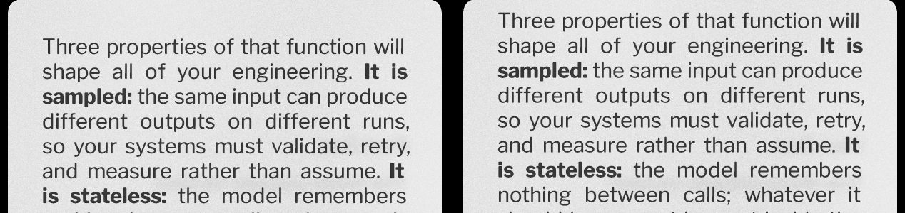

# Font resize: the flash and the jitter (2026-10-11)

**Owner report, verbatim:** *"subagent for to not flash display and jitter layout
on font resize"*. Taken as stated: on the iPhone app, a font-size step in the
reader (zen's 2-finger swipe left/right, pinch/spread, or a pad side-button tap
-- all of them `gpio.queueButtonTap(BTN_DOWN/UP)`, which the reader turns into
`stepReaderFontSize`) flashes the display and jitters the layout.

**Status: both fixed in the simulator, SHIPPED -- UNCONFIRMED on device.**
Measured on the iOS Simulator (iPhone Air, iOS 26.5, Debug build of this tree);
no phone was available to this session.

## The path, trigger to glass

1. `ios/CrossPointZenRecognizers.mm` `performGestureAction` -> `gpio.queueButtonTap(BTN_DOWN|BTN_UP, 60)`
   (2-finger swipe left/right and spread/pinch, `ios/GestureBindings.h` defaults).
2. Firmware `EpubReaderActivity::loop` (side-button tap branch, `longPressButtonBehavior == FONT_SIZE_STEP`)
   -> `stepReaderFontSize` (`crosspoint-reader/src/activities/reader/EpubReaderActivity.cpp:671`):
   captures the paragraph/word anchor, `section.reset()`, writes the slot, `ensureLoaded`, `requestUpdate()`.
3. `EpubReaderActivity::render` (`:1073`) **publishes the reader's text insets at its top**
   (`gpio.publishReaderTextInsets`, `:1135`) -- before the section is rebuilt and before any pixel of the
   new page is drawn. The top inset carries the cap-ink trim, which changes with the font size
   (measured 14 -> 12 fb px for slot 3 -> 4 of Edgar).
4. iOS main thread, every frame: `pollReaderInsets` (`ios/CrossPointIOSShim.cpp`, zen only) sees the new
   pair -> `zenPreWarmLayout()` -> `SimulatorOverlay::requestPresent()`.
5. Meanwhile the render task rebuilds the chapter (~10-150 ms), then `renderContents` draws the 1-bit
   pass (`displayBuffer` -> `renderBwPixels`, which arms the 30 ms coalescing hold), then the AA planes,
   then the compose (`composeGrayscalePreview`, which releases the hold).

## Mechanism 1 -- the JITTER: the host re-placed the OLD page

Step 4 happens during step 5's rebuild, so the relayout's present shows the page that is still in
`pixelBuf` -- the old one -- in the new placement. Measured in the screen recording of the before arm
(`before2`, step 1): the old page's text sits **72 device px higher** for **~360 ms**
(video frames 10.703 s and 11.065 s) with the paper unmoved, and only then does the new page sweep in at
the normal place. Same font size, same line breaks as the frame before -- it is the old page, displaced:



Frame strips, top half of the glass, half resolution (context figure, video-decoded, h264):
`font-resize-flash-jitter-2026-10-11/before-step1-frames.png` (frame 2 is the displaced old page) and
`after-step1-frames.png` (the old page holds still, then the beam sweeps the new one in).

Every before-arm log shows the ordering: `[zen] published ink insets ... -> relayout` and
`[zen] panel ...` BEFORE the step's `[GFX] ... displayBuffer`; every after-arm log shows them after it.

**Not traced:** why that transient lands 72 px off when the settled placement only moves 1 px per step
(`[zen] panel 1056x1584 at 102,380` <-> `102,381`, the ruled C32 construction following the cap trim).
The fix removes the window in which any present can happen, so the transient's exact geometry no longer
matters to the report; it is recorded so nobody claims it was explained.

## Mechanism 2 -- the FLASH: a present already in flight uploaded the 1-bit frame

`presentIfNeeded` asked the coalescing hold once, at `src/HalDisplay.cpp` (the `holdUntil` check),
**without** `pixelBufMutex`. The 1-bit writer (`renderBwPixels`) arms the hold **inside** that lock,
after writing the frame. A present that passed the check with nothing held -- the relayout's present
from mechanism 1 -- then blocked on the lock while the 1-bit pass wrote, and uploaded the 1-bit frame:
the full-screen hard black-and-white page the hold exists to suppress. A page turn never shows it because
nothing presents in that window; a font step does because the relayout asked for a present 50-60 ms
before the 1-bit write. Measured with `CROSSPOINT_SIM_LOG_PRESENTS=1`, which tags the writer of each
presented frame:

| arm | font steps | presents tagged `frame from B` on a step |
|---|---|---|
| before1 | 6 | 0 |
| before2 | 6 | 5 (steps 1, 3, 4, 5, 6) |
| run2 (first repro) | 2 | 1 (`[present] #9 at 9017 ms, frame from B`, 63 ms after the relayout) |
| after1 / after2 / after3 | 6 / 6 / 6 | **0 / 0 / 0** |

The hold-race is timing dependent, which is why before1 shows none. Every after run logs six
`[present] declined: a pixel write armed the hold while this present waited for the frame` -- the new
check catching exactly the present that would have been the flash.

## The fix (simulator only, no firmware change)

1. **Insets go live with their page** -- `StagedReaderInsets` in `src/ReaderInsetsChannel.h`.
   `HalGPIO::publishReaderTextInsets` now STAGES; both pixel writers in `src/HalDisplay.cpp`
   (`renderBwPixels`, `composeGrayscalePreview`) call `SimulatorOverlay::commitReaderTextInsets()` when
   they write a new picture (never on a reconvert, `reconvertingFrame`), under the pixel lock and before
   they arm the hold. The host's relayout therefore follows the new page's 1-bit write, its present is
   held with that frame, and the new placement and the composed new page land on one present. Same
   shape as the firmware's turned-page fix (publish after the first `displayBuffer`, review 2026-10-04
   finding 5), done host-side so the firmware is untouched.
2. **The hold is asked again under the lock** -- `src/PresentHold.h` `presentheld::held`, used by both
   checks in `presentIfNeeded`. If a pixel write armed the hold while the present waited, the present is
   declined and left OWED (`pendingPresent` set again), exactly like the first check.

Tests: `tests/reader_insets_channel_test.cpp` (staged case: invisible until committed, the old insets
stay readable until the new page is written, the later of two publishes wins) and
`tests/present_hold_test.cpp` (0 = no hold, a due screenshot wins, the deadline is exclusive, the race).
Both are in `tests/run_all.sh` with their rationale.

## What was checked and found CLEAN

- **First render / boot** (after1-3): no 1-bit present at boot; the first relayout follows the first page.
- **Zen placement when the insets legitimately change**: every after-arm step still re-places the page
  (`[zen] panel ... 102,380 <-> 102,381`, six per run), now after the page is written.
- **Out of zen** (`afterNoZen`, 6 steps): no 1-bit present on any step. `pollReaderInsets` is zen-only,
  so out of zen only mechanism 2 could ever apply.
- **`CROSSPOINT_SIM_PRESENT_FLASH=1`** (desktop, 3 runs): the new check never fired (`declined 0`); with
  the flash on, `renderBwPixels` stores hold 0, so the predicate answers "not held". Whether the desktop
  catches the deliberate flash at all is timing-dependent in BOTH builds (old build: 1 B present over 3
  renders in one run) -- unchanged by this.
- **A frame with no second pass** (AA off, menus): the re-check uses the same bounded deadline as the
  first check and re-owes the frame, so it presents at most 30 ms late, as before. Reasoned, not run.
- **Reconverts** do not commit insets, so a palette flip mid-render cannot publish a page not yet drawn.
- **Desktop canary** (`pio run -e simulator_x3`, AS_SHIPPED, 2x, 2 steps): 0 B presents, identical to
  the old build.
- Host tests run: `reader_insets_channel`, `present_hold`, `glass_capture`, the five `zen` tests,
  `test_sleep_wake`, `test_foreground_wake`, `test_queued_tap_wake`, `test_read_aloud_capture` -- all PASS.

## Found and NOT fixed (outside the ask)

**A reconvert after a finished AA page drops the antialiasing.** `reconvertLastFrame` recomposes only
when the AA planes are still valid, but `cleanupGrayscaleBuffers` -> `snapshotBwBase` clears them at the
end of every AA page, so any later reconvert (an appearance/palette change) renders the 1-bit base: the
page loses its gray levels until the next page is drawn. Seen at boot in `afterNoZen` and `before1`
(`[present] #1 ... frame from B, mean luma 228.2` after the page had composed). Its own comment claims the
planes "are still cached"; they are not. Pre-existing, unrelated to font size; a proposal, not a change.

## UNCONFIRMED on device -- what to observe

On the phone, in zen, step the font size (2-finger swipe left/right) a few times. Expect: the old page
holds still, then the new page arrives (the CRT beam sweep, as on any page turn) at its settled place --
no page jumping up for a moment, no hard black-and-white frame. With Diagnostics Log on,
`diagnostics/firmware.log` should carry one `[present] declined: a pixel write armed the hold ...` line
when the race would have fired, and no `frame from B` line on a step (the latter only with
`CROSSPOINT_SIM_LOG_PRESENTS`).

## Method (re-runnable)

Scripts beside this doc. iOS Simulator build of the working tree (seed fonts copied with `cp -cR` from
`crosspoint-reader/fs_/fonts`):

```bash
cmake -S . -B $SP/ios-sim -G Xcode -DCMAKE_SYSTEM_NAME=iOS -DCMAKE_OSX_SYSROOT=iphonesimulator \
  -DCMAKE_OSX_ARCHITECTURES=arm64 -DCROSSPOINT_FIRMWARE_DIR=$HOME/src/crosspoint-reader \
  -DCROSSPOINT_BUILD_FIRMWARE=ON -DCROSSPOINT_IOS_SEED_FONTS_DIR=$SP/seedfonts \
  -DFETCHCONTENT_SOURCE_DIR_SDL3=$PWD/build/ios-dev/_deps/sdl3-src
cmake --build $SP/ios-sim --config Debug --target CrossPointX3
xcrun simctl install <udid> $SP/ios-sim/ios/Debug-iphonesimulator/CrossPointX3.app
# once: SIMCTL_CHILD_CROSSPOINT_SIM_IMPORT_FILE=<epub> xcrun simctl launch ... (imports and opens it)
SP=$SP ./arm.sh after1      # pins readerActivityLoadCount=0, records video, 3 page turns + 6 font steps
python3 frames.py after1.mov fr_after1 && python3 steps.py fr_after1
```

`arm.sh` reports the step count, the 1-bit presents and the declines from the log; `steps.py` scores each
video frame against the settled frames before and after each step (a frame matching neither for longer
than the ~55 ms beam sweep is the defect). Limits: the recording is h264, so it can show a displaced
page but cannot tell a 1-bit frame from an AA one -- the present log is the instrument for the flash;
the beam sweep itself is a designed transition (owner ruling 2026-08-26) and is not counted.
The before arm was built by checking out the three changed `src/` files at HEAD (`f1436d1`), building,
and restoring them.
